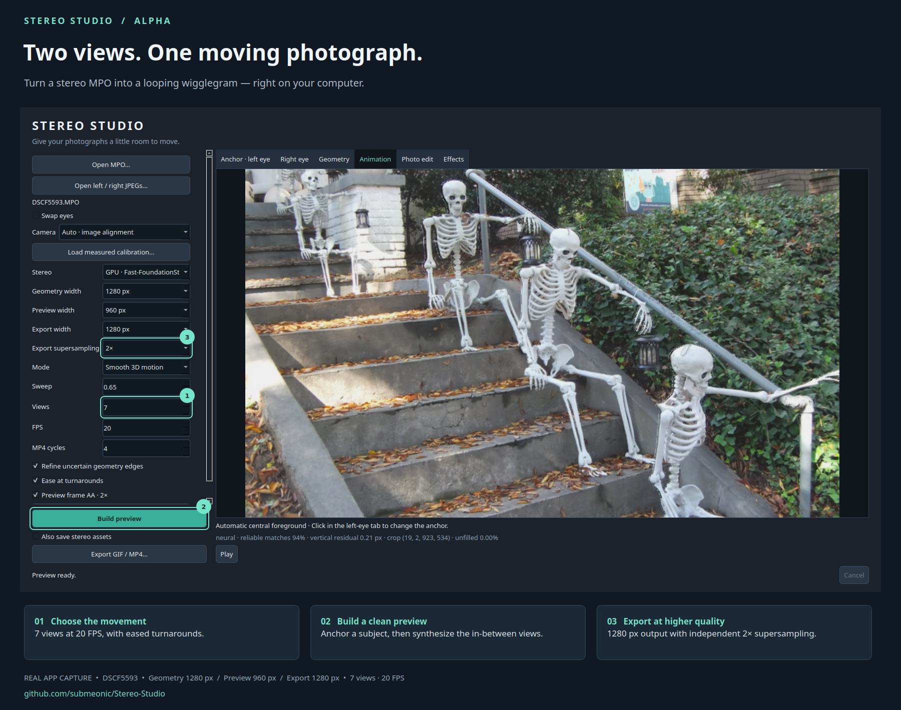
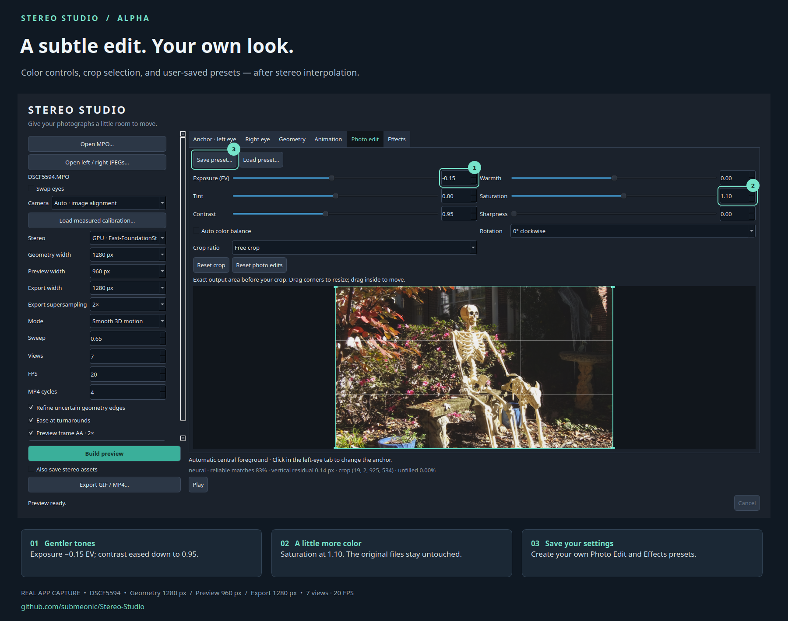
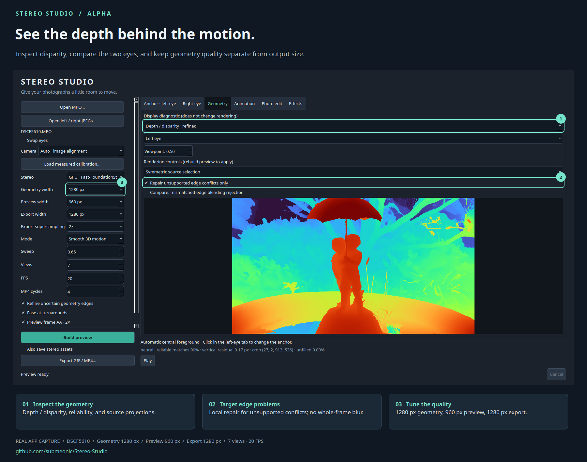
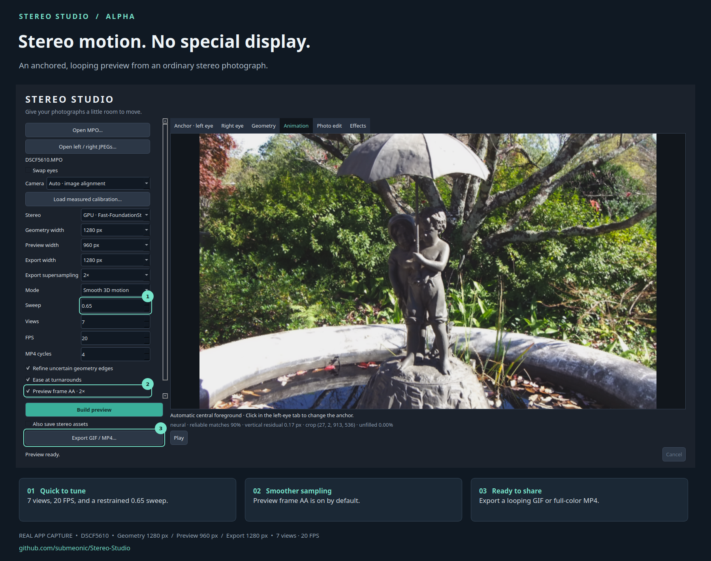

# Your first wigglegram

This illustrated walkthrough uses actual alpha app captures with Fujifilm W3 photographs. The examples use the default render settings, with exposure at **−0.15 EV**, contrast at **0.95**, and saturation at **1.10**. The screenshots are still images; export a GIF or MP4 to see the motion.

## 1. Import a stereo photograph

Open an MPO containing both eyes, or use **Open left / right JPEGs** and choose the eyes in that order. An MPO's accompanying JPEG is not needed. Choose the nominal camera profile matching W3 or Nintendo 3DS. If apparent depth is reversed, inspect the eye images and try **Swap eyes**.

Nintendo's outer-camera photos are saved as MPO stereo data with a separate JPEG, as described in the [Nintendo 3DS Camera documentation](https://www.nintendo.co.jp/hardware/3dsseries/camera/index.html). Select the MPO. The 3DS profile uses the same image-based vertical alignment strategy as other nominal profiles; it supplies no invented lens calibration. Native source dimensions are preserved during analysis when smaller than the requested width. Upscaling cannot recover absent detail.

## 2. Anchor the subject

In **Anchor · left eye**, click a textured part of the subject you want to hold still, preferably away from its silhouette. A crosshair appears immediately. The app resolves its disparity when it builds the preview. **Use automatic anchor** chooses a central foreground region. If a click cannot be verified, the status explains the automatic fallback.

The anchor controls which depth stays steady; it does not cut out the subject or remove all motion from an object spanning several depths.

## 3. Set the motion and quality

Start with **Smooth 3D motion**, sweep **0.65**, **7 views**, **20 FPS**, and eased turnarounds. Larger sweep gives more movement but exposes more occlusion errors. More views at the same FPS produces a longer, smoother sweep.

The desktop defaults to 1280 px geometry, 960 px preview, and 1280 px export. Preview AA and 2× export supersampling are enabled independently. Geometry is cached, so changing color or motion does not require new stereo inference. Reducing preview width can make experimentation faster without lowering export width.

Use **Classic two-frame** to alternate the captured eyes without synthesizing intermediate views. Use **Anaglyph 3D** for one still image viewed through red-left/cyan-right glasses; motion and temporal effects are unavailable there.



The numbered callouts highlight motion settings, preview building, and export quality.

## 4. Edit the photograph

In **Photo edit**, adjust exposure, warmth/tint, saturation, contrast, or sharpness. Auto color balance applies one shared correction across both eyes. Photo adjustments run after stereo estimation and view interpolation, so artistic edits do not confuse stereo matching.

Choose rotation and crop aspect ratio. Draw a crop rectangle, drag inside to move it, or drag a corner to resize it. Before the first build this is provisional framing; after a build it uses the common visible output region. Rotation resets the crop. Curvature, if enabled, shows a gold outline of the sampled region inside your crop.



Use the sliders or numeric fields for subtle adjustments, then save your look as a Photo Edit preset.

## 5. Add effects if desired

Every group in **Effects** has an independent toggle. Enabled groups reveal sliders and exact numeric fields. Effects follow chronological playback, including the return sweep. Try a modest persistence amount, a small RGB split, or rolling scanlines, then compare using **Bypass all effects**.

**Cycles / loop** counts whole cycles during a complete forward-and-return loop. Rates too high for the available frames are rejected. Light leaks remain fixed in space and affect the requested number of playback frames, optionally in bursts. Curvature crops inward to avoid black borders. Check [the glossary](GLOSSARY.md) for each effect.

There are no bundled artistic presets. Both **Photo edit** and **Effects** have **Save preset** and **Load preset** buttons:

- Photo presets save all photo values, rotation, crop rectangle, and crop aspect selection. Loading replaces those settings, so inspect framing on each new photo.
- Effects presets save every effect's numeric values, enabled toggles, and global bypass state, including values in disabled groups.
- Files are versioned JSON and contain no photos, source paths, camera calibration, anchor, or rendering-quality settings. Photo and Effects files are separate and cannot be loaded into the wrong panel.
- Import the photo first, then load a preset. Loading invalidates the preview. Build again to see the result. Keep your personal library in `user-presets/` (ignored by Git), or any folder you choose. Saving to an existing file replaces it after the save dialog's confirmation.

## 6. Build and inspect

Click **Build preview**. Watch the status; **Cancel** stops between processing stages. Use **Animation** to judge the loop and **Pause** to inspect a frame. If settings change, build again before export. With effects disabled, most photo adjustments update the existing preview immediately; active temporal effects require rebuilding their history.

In **Geometry**, use **Depth / disparity**, match reliability, left/right projections, source contribution, disagreement, or the repair mask. Display choices do not change rendering. The separate processing controls do: symmetric fusion and local edge repair are the normal choices; legacy/left/right priorities are comparisons. The numerical viewpoint field controls projection diagnostics at analysis resolution.

If an edge looks wrong, try a smaller sweep or another anchor. Preview AA and export supersampling reduce sampling jaggies, not incorrect depth. Local repair is deliberately restricted and does not blur the whole image.



Use these diagnostics to inspect depth and edge problems, then return to Animation to judge the result.

## 7. Export

Choose **Export GIF / MP4**, or **Export JPEG** in Anaglyph mode. Export renders from original source colors at the selected export grid, then applies edits and effects. It does not simply enlarge the preview. MP4 repeats the chosen number of cycles; GIF loops indefinitely. Actual MP4 repeat behavior afterward depends on the player.

**Also save stereo assets** writes a separate bundle of aligned eye images, disparity/reliability maps, and a settings manifest. Existing asset directories are preserved; use a new name. See [asset format](ASSET_FORMAT.md).

Final width is the export width after crop; height follows the aspect ratio and is rounded to an even number. A tight crop or low-resolution source reduces the benefit of supersampling. Originals are not modified.



Check the loop in Animation before exporting. The still capture above shows the edited photograph; the exported animation supplies the changing viewpoint.

A saved Effects preset also works in the CLI:

```bash
.venv/bin/python -m wigglegram render photo.mpo --effects-json user-presets/effects.json -o outputs/effects.mp4
```

The saved bypass state is honored. The CLI also accepts a plain JSON object of enabled effect names and parameters; GUI preset files preserve more editing state than that minimal form.
